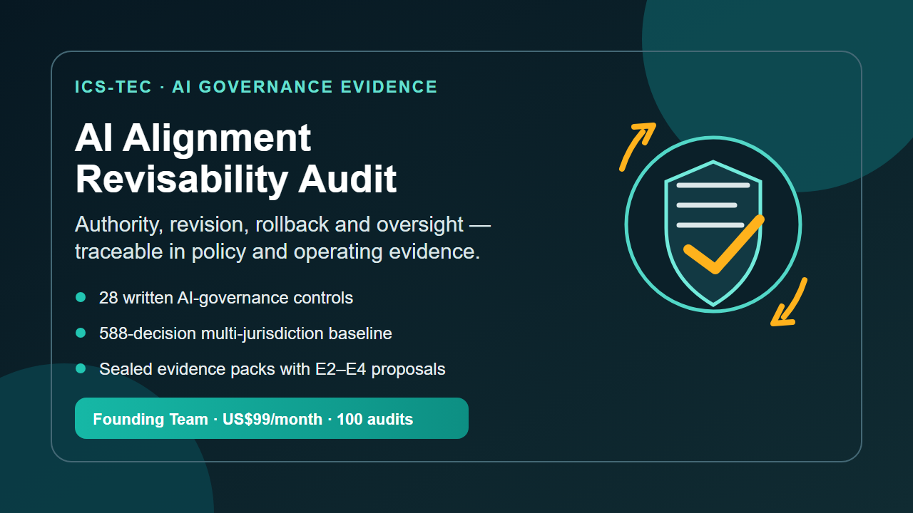
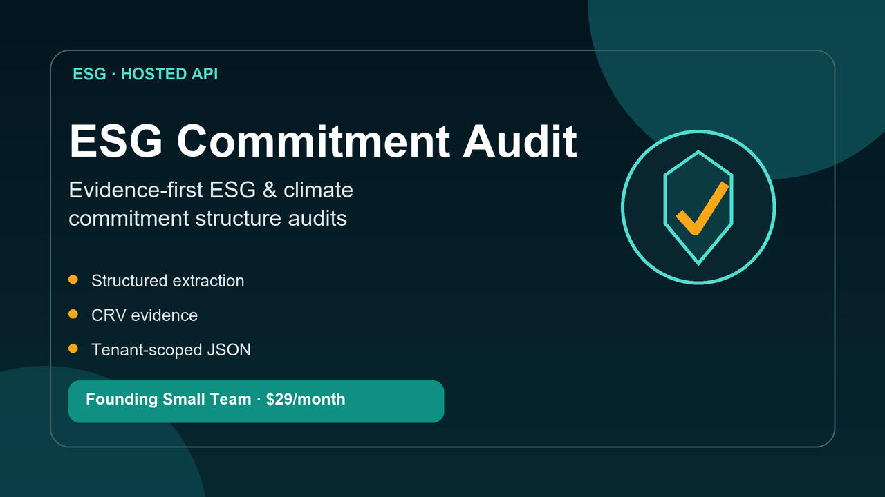

# ICS Audit Tools for MCP-compatible AI agents

Two independent audit products, published as separate Codex plugins:

1. **AI Alignment Revisability Audit** — for AI policies, constitutions, model
   cards, governance frameworks and sealed operating evidence.
2. **ESG Commitment Audit** — for sustainability and climate commitments in
   long reports.

The products share an MCP implementation, hosted API and account controls. They
do not share a plan, API key, activation page or product scope.

Current release: [`v0.6.2`](docs/RELEASE_CHECK_V062.md) ·
[release notes](docs/PLUGIN_RELEASE_NOTES_V062.md)

## Product 1 — AI Alignment Revisability Audit



### What it answers

Can an AI policy be changed, challenged, rolled back and independently
reviewed? Where is the written authority? What evidence exists that a control
operated rather than merely being promised?

The audit reviews **28 written governance controls** across:

- alignment targets and scope;
- accountable owners and revision authority;
- review cadence, version history and notice;
- appeal, human review, refusal, opt-out and exit;
- monitoring, audit logs and technical-control evidence;
- rollback, suspension and deprecation;
- independent oversight and affected-party safeguards.

Five profiles are available: general AI governance, news media, advertising,
insurance and industrial design. Industry profiles add two dedicated
safeguards and therefore return 30 checks.

### Evidence and benchmark

- Every supported finding carries source evidence.
- The sealed evidence-pack workflow verifies SHA-256 pins and proposes
  human-confirmed E2, E3 or E4 upgrades.
- The benchmark covers 21 public AI-policy and regulatory documents with 588
  check-level decisions across the EU, UK and United States.
- Document-only review distinguishes asserted, documented, contradicted and
  missing controls. It does not pretend that a written control operated.

### Commercial offer

- **US$99/month**
- 100 policy or evidence-pack jobs per month
- One organization and one shared API key
- Up to 100 pages and 50 MB per policy document
- Up to 100 MB compressed evidence pack, with a 200 MB uncompressed limit
- Seven-day hosted report retention
- First 20 customer organizations
- 30-day no-questions-asked full refund

[Gumroad offer](https://icsstudies.gumroad.com/l/ai-alignment-revisability-audit) ·
[Activate the AI license](https://esg-commitment-audit-api.franka328162810.workers.dev/ai-revisability-audit/activate) ·
[Product page](https://esg-commitment-audit-api.franka328162810.workers.dev/ai-revisability-audit) ·
[Plugin details](plugins/ai-alignment-revisability-audit/README.md)

### Install the AI plugin

```powershell
codex plugin marketplace add franka328162810-cell/esg-commitment-audit --ref main
codex plugin add ai-alignment-revisability-audit@ics-tec
$env:ICS_AUDIT_API_KEY = "<AI API key>"
```

Example prompt:

```text
Use $ai-alignment-revisability-audit to audit this AI policy for revision
authority, rollback, affected-party safeguards and operating evidence.
```

## Product 2 — ESG Commitment Audit



### What it answers

What exactly did the organization promise? Where is the supporting text? Can
progress be measured? Who owns delivery? Can the commitment be revised?

The ESG product extracts written commitments from text-layer PDF, DOCX, TXT and
Markdown reports, then tests the ICS CRV structure:

- **Observability:** baseline, target, scope, method and reporting;
- **Enforceability:** owner, governance, assurance and remedy;
- **Revisability:** review cadence, revision trigger and exit conditions.

Every supported score must carry page- or paragraph-level evidence. Missing
evidence remains explicitly missing instead of being filled in by assumption.

### Commercial offer

- **US$29/month**
- 100 audited documents per month
- One organization and one shared API key
- Up to 100 pages and 50 MB per document
- Seven-day hosted report retention
- First 20 customer organizations
- 30-day no-questions-asked full refund

[Gumroad offer](https://icsstudies.gumroad.com/l/esg-commitment-audit) ·
[Activate the ESG license](https://esg-commitment-audit-api.franka328162810.workers.dev/activate) ·
[Customer guide](docs/PRODUCT_GUIDE.md) ·
[Plugin details](plugins/esg-commitment-audit/README.md)

### Install the ESG plugin

```powershell
codex plugin marketplace add franka328162810-cell/esg-commitment-audit --ref main
codex plugin add esg-commitment-audit@ics-tec
$env:ICS_AUDIT_API_KEY = "<ESG API key>"
```

Example prompt:

```text
Use $esg-commitment-audit to extract this report's climate commitments and show
missing baseline, ownership, remedy or revision evidence with page citations.
```

## Product separation

| Item | AI Alignment Revisability Audit | ESG Commitment Audit |
|---|---|---|
| Primary user | AI policy, governance, risk and assurance teams | Sustainability, climate and procurement teams |
| Object reviewed | AI policies, constitutions, model cards and evidence packs | ESG and climate reports |
| Core method | 28 written controls plus two industry safeguards | Commitment extraction plus CRV structure checks |
| Hosted modes | `ai-revisability`, `evidence-pack` | `commitment`, `recursive-freedom` |
| Price | US$99/month | US$29/month |
| Activation | `/ai-revisability-audit/activate` | `/activate` |
| API-key prefix | `ai_live_` | `esg_live_` |

The service rejects a key from the wrong product before the uploaded document is
transferred.

## Shared infrastructure

The common layer provides:

- one dependency-free MCP server synchronized into both self-contained plugins;
- product-specific tools, prompts, permissions and activation guidance;
- tenant-scoped hosted jobs, quotas, reports and deletion;
- approval prompts for upload and deletion;
- separate ESG and AI plans and product-isolated API keys;
- local stdio, remote Streamable HTTP and cross-client adapters.

Remote MCP endpoints:

```text
https://esg-commitment-audit-mcp.franka328162810.workers.dev/mcp/ai
https://esg-commitment-audit-mcp.franka328162810.workers.dev/mcp/esg
```

Codex and Claude Code stdio adapters are verified. Hermes and WorkBuddy remain
templates until their lifecycle tests pass. See
[Cross-client distribution](docs/CROSS_CLIENT_DISTRIBUTION.md).

## Local package

The Python distribution is shared, while the product commands and modes remain
independent.

```powershell
python -m venv .venv
.\.venv\Scripts\python.exe -m pip install -e ".[dev]"

ai-revisability-audit audit examples\revisability_strong_policy.md
esg-commitment-audit audit examples\strong_commitment.txt
```

The local server binds to `127.0.0.1` by default and does not upload documents.

## Validation

```powershell
python -m pytest
python -m ruff check src tests validation scripts
python -m ruff format --check src tests validation scripts
node --test plugins\core\server.test.mjs plugins\core\bundles.test.mjs
```

The frozen ESG extraction gate retains 98.63% candidate precision, 93.75%
unique-commitment recall, 100% E/S/G top-level accuracy and 100% page citation
coverage. The AI benchmark and methodology are documented separately in
[AI Alignment Revisability Audit](docs/AI_ALIGNMENT_REVISABILITY_AUDIT.md) and
[Evidence-pack workflow](docs/EVIDENCE_PACK_WORKFLOW.md).

## Claims boundary

These products review written governance and commitment structure plus submitted
evidence. They do not certify AI safety, legal compliance, assurance, model
alignment, environmental performance or the truth of an organization's claims.
The AI product must not be used to score an individual's personality, rights,
employment, credit, insurance, education, immigration, political status or
legal culpability.

## License

Code and rules are licensed under Apache License 2.0. Future formalizations under
`formalizations/` are intended to be licensed separately under CC BY-SA 4.0; no
formal proof is included in `v0.6.2`.

Copyright 2026 Xue Zhi Xin (ICS-TEC).
