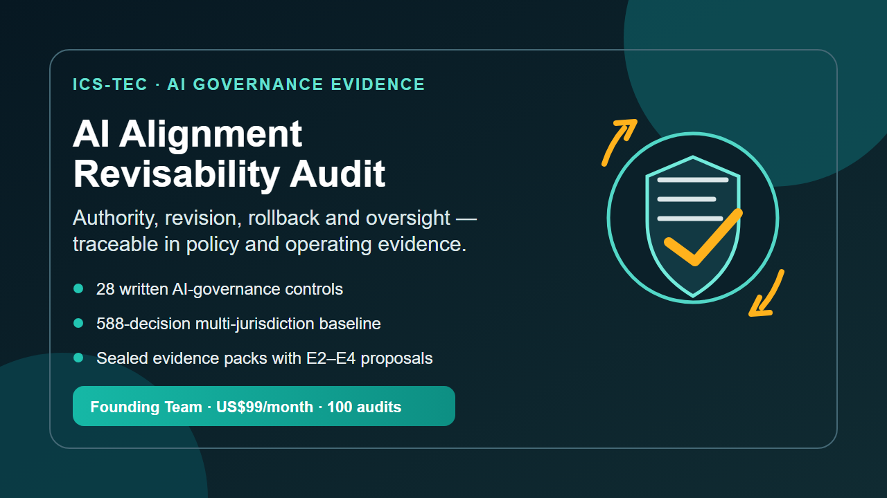

# AI Alignment Revisability Audit



An independent Codex plugin for reviewing whether AI policies, constitutions,
model cards and governance frameworks define who can change the rules, how
changes are challenged and rolled back, and what operating evidence exists.

## Included

- 28 written governance controls.
- General, news-media, advertising, insurance and industrial-design profiles.
- Evidence grades from absent through independently verified.
- Sealed evidence-pack review with human-confirmed E2/E3/E4 proposals.
- Product-specific API-key checks before upload.

## Hosted offer

US$99/month for 100 policy or evidence-pack jobs, one organization, one shared
API key and the first 20 customer organizations.

- [Gumroad](https://icsstudies.gumroad.com/l/ai-alignment-revisability-audit)
- [Activate](https://esg-commitment-audit-api.franka328162810.workers.dev/ai-revisability-audit/activate)
- [Product page](https://esg-commitment-audit-api.franka328162810.workers.dev/ai-revisability-audit)
- [Full documentation](../../docs/AI_ALIGNMENT_REVISABILITY_AUDIT.md)

## Install

```powershell
codex plugin marketplace add franka328162810-cell/esg-commitment-audit --ref main
codex plugin add ai-alignment-revisability-audit@ics-tec
$env:ICS_AUDIT_API_KEY = "<AI API key>"
```

This plugin is not an ESG audit add-on. It requires an `ai_live_` key from the AI
product and rejects an ESG key before uploading a document.
