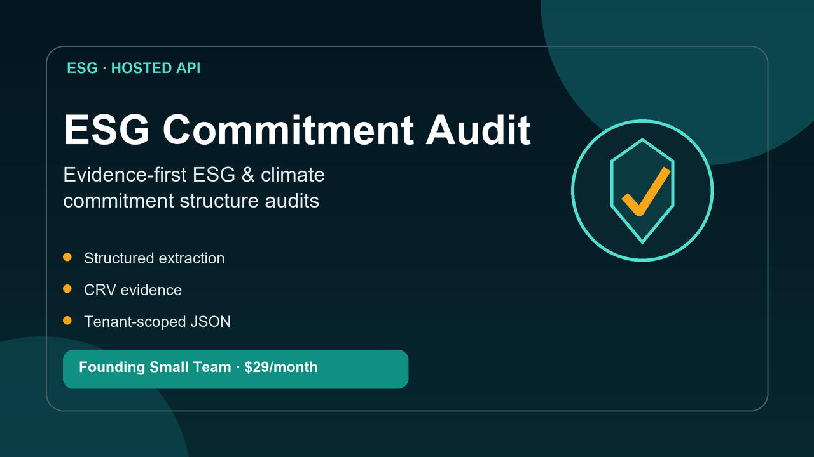

# ESG Commitment Audit



An independent Codex plugin for extracting sustainability and climate
commitments from long reports, tracing each finding to source evidence, and
testing observability, enforceability and revisability.

## Included

- Chinese and English commitment extraction.
- Page- or paragraph-level evidence.
- ICS CRV dimension checks and configurable weighting presets.
- Explicit missing evidence rather than filled-in assumptions.
- Product-specific API-key checks before upload.

## Hosted offer

US$29/month for 100 audited documents, one organization, one shared API key and
the first 20 customer organizations.

- [Gumroad](https://icsstudies.gumroad.com/l/esg-commitment-audit)
- [Activate](https://esg-commitment-audit-api.franka328162810.workers.dev/activate)
- [Customer guide](../../docs/PRODUCT_GUIDE.md)
- [Methodology](../../docs/METHODOLOGY.md)

## Install

```powershell
codex plugin marketplace add franka328162810-cell/esg-commitment-audit --ref main
codex plugin add esg-commitment-audit@ics-tec
$env:ICS_AUDIT_API_KEY = "<ESG API key>"
```

This plugin is not an AI-governance add-on. It requires an `esg_live_` key from
the ESG product and rejects an AI key before uploading a document.
